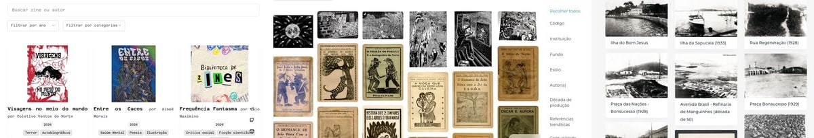

# Coleção de Acervos Digitais

[](https://viveiro-digital.github.io/acervos-digitais-colecao/)

Um catálogo de acervos comunitários do Brasil e da América Latina. Aqui tem fanzines enviados por quem os faz, fotografias da Maré e jornais do movimento negro. Em cada ficha, você encontra quem cuida do acervo e onde consultar o material.

[**Passeie pelas coleções**](https://viveiro-digital.github.io/acervos-digitais-colecao/)

Conhece um acervo que devia estar aqui? [Conta pra gente.](https://github.com/viveiro-digital/colecao-de-acervos-digitais/issues/new)

## Rodar localmente

Use o Node indicado em [`.nvmrc`](.nvmrc).

```sh
pnpm install
pnpm dev
```

[Metodologia](METODOLOGIA.md) · [Catalogação](docs/CATALOGACAO.md) · [Como contribuir](CONTRIBUTING.md)

Um projeto do [Viveiro Digital](https://viveiro-digital.github.io/recursos/).
